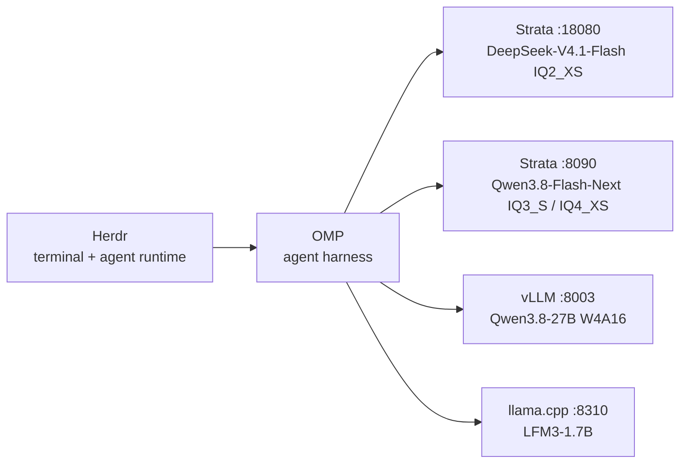

# local-ai-stack

A local-first AI stack on one workstation: three RTX 3090s, a custom C++/CUDA
inference engine, vLLM and llama.cpp servers, an agent harness, and a
terminal/agent runtime.

No cloud model API is required for the local roles. The only cloud provider in
the OMP config is an optional OpenRouter copy of the same model, used as a
fallback when a local server is offline.

## Hardware

| | |
|---|---|
| GPUs | 3 × RTX 3090, 24 GB each (indices 0, 1, 2) |
| CPU | 48 threads |
| RAM | 247 GB |
| OS | Ubuntu 26.04.1 LTS |
| Removed card | 4th RTX 3090 (serial `1324221009624`) had stuck-at-1 VRAM cells; removed 2026-10 |

The launch scripts retain historical comments from the four-card period.
Where a GPU list mattered, the configs here were updated to the current
three-card layout (`0,1,2`); the README says so where that happened.

## Stack



| Port | Server | GPUs | Model | Notes |
|---:|---|---|---|---|
| 18080 | Strata container `strata-dsv41` | 0,1,2 | DeepSeek-V4.1-Flash-1017, IQ2_XS 2.25 bpw | 256K context, OpenAI-compatible |
| 8003 | vLLM | 0,1 | Qwen3.8-27B W4A16 AutoRound, TP=2 | 262K context; only when running |
| 8310 | llama.cpp | 0 | LFM3-1.7B Q8_0 | 262K native context, tool calls |
| 8090 | Strata (Python server) | 0,1,2 | Qwen3.8-Flash-Next IQ3_S or UD-IQ4_XS | one variant at a time |
| 18090 | llama.cpp | 2+3 | Tess-4.5-27B | historical layout; not current production |

**GPU rule:** a card holds one model at a time. The Strata container and the
vLLM/llama.cpp servers compete for the same cards; stop the current server
before starting another. `local-ai/stop-inference.sh` kills GPU holders by PID,
not by command-line pattern.

## Measured performance

| Model | Engine | Context | Decode | Source / date |
|---|---|---:|---:|---|
| DeepSeek-V4.1-Flash IQ2_XS | Strata 0.2.12 / engine 0.1.58 | 256K | 62–66 tok/s | 2026-11-08, DSpark drafter on |
| Qwen3.8-Flash-Next IQ3_S | Strata | 262K | 112–137 tok/s | 2026-10-08 |
| Qwen3.8-Flash-Next UD-IQ4_XS | Strata | 262K | ~140 tok/s | 2026-10-07 |
| Qwen3.8-27B W4A16 AutoRound | vLLM TP=2 | 262K | 57–73 tok/s | 2026-09-06, healthy pair |
| LFM3-1.7B Q8_0 | llama.cpp | 262K | 310 tok/s | 2026-10-28, one card |
| Tess-4.5-27B | llama.cpp | 262K | 57–65 tok/s | historical two-card layout |

Decode figures are single-stream and model-specific; the long-context
prefill numbers live in the script comments. Model weights are not included in
this repository — they are 19 GB (27B), 1.8 GB (LFM3), or multi-tens-of-GB
(Strata packs), and are downloaded/build separately.

## Repository layout

```
herdr/       config.toml + plugins.json + install notes
omp/         config.yml + models.yml + AGENTS.md + env.example + notes
local-ai/    production launch scripts and Strata JSON configs
docs/        architecture and model notes
```

## Quick start

This is a snapshot for a host laid out like the one above. Paths in the
scripts are host-specific (`/home/froid/strata`, `~/models`,
`~/vllm-env-028`); adapt them before running elsewhere.

```bash
git clone https://github.com/froid1911/local-ai-stack
cd local-ai-stack

# 1. OMP config
cp omp/config.yml   ~/.omp/agent/config.yml
cp omp/models.yml   ~/.omp/agent/models.yml
cp omp/env.example  ~/.omp/agent/.env   # fill OPENROUTER_API_KEY if you want the cloud fallback

# 2. Herdr config
cp herdr/config.toml ~/.config/herdr/config.toml

# 3. Start a local model (pick one)
local-ai/strata/start-dsv41-container.sh
# or: local-ai/vllm/start-27b-w4a16.sh
# or: local-ai/llama.cpp/start-lfm3.sh
```

The Strata container expects the image `strata-base:24.04` and the Strata
runtime under `$HOME/.local/share/strata/`; see `local-ai/README.md`.

## Upstream projects

- **Herdr** — https://herdr.dev · https://github.com/herdrdev/herdr (Apache-2.0)
- **OMP / oh-my-pi** — https://omp.sh · https://github.com/can1357/oh-my-pi
- **Strata** — https://github.com/Niko1221/Strata

## License

MIT for the configuration and scripts in this repository. Upstream projects
keep their own licenses.
